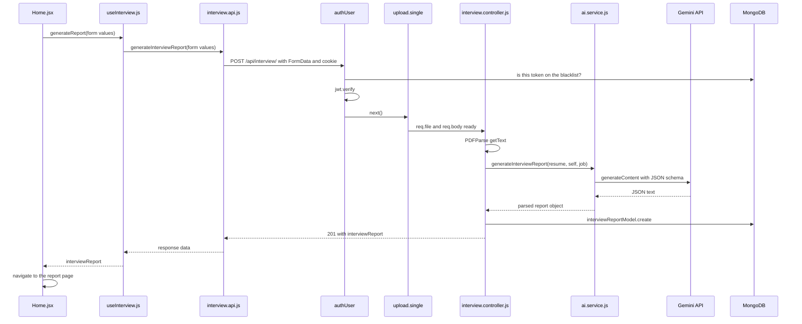

# How the code runs

This file follows the code from the moment you start it, through every user action, file by file and function by function.

Notation used below:

- `file.js › functionName()` means "the function `functionName` inside `file.js`".
- An arrow `→` means "then calls" or "then goes to".
- Paths start at `Backend/` or `Frontend/`.

---

## 1. The big picture

There are two separate programs, plus three outside services.

| Part | Runs where | Port | Started by |
|---|---|---|---|
| Frontend (React) | your browser | 5173 | `cd Frontend && npm run dev` (Vite) |
| Backend (Express API) | Node.js on your machine | 3000 | `cd Backend && npm run dev` (nodemon) |
| MongoDB | MongoDB Atlas or local | | connection string in `Backend/.env` |
| Gemini API | Google's servers | | API key in `Backend/.env` |
| Chrome | your machine, started by Puppeteer | | only while a PDF is being made |

The browser only ever talks to the backend. The backend talks to MongoDB, Gemini and Chrome. The Gemini key never reaches the browser.

```
Browser (React, :5173)  ──HTTP + cookie──▶  Express API (:3000)  ──▶  MongoDB
                                                   │
                                                   ├──▶  Gemini API (Google)
                                                   └──▶  Chrome via Puppeteer (PDFs only)
```

---

## 2. Backend start-up (entry point: `Backend/server.js`)

`npm run dev` runs `npx nodemon server.js`. nodemon starts `server.js` and restarts it whenever a file changes.

`server.js` runs top to bottom:

1. **Line 1: `require("dotenv").config()`**
   Reads `Backend/.env` and puts its values into `process.env`: `GOOGLE_GENAI_API_KEY`, `MONGO_URI`, `JWT_SECRET`, `PUPPETEER_EXECUTABLE_PATH`.
   dotenv looks for `.env` in the folder you started from, so you must start the server from inside `Backend/`.

2. **Line 2: `require("./src/app")`**
   Loading `app.js` runs it, and that loads almost every other backend file (see the load order below).

3. **Line 3: `require("./src/config/database")`**
   Loads `connectToDB`.

4. **Line 5: `connectToDB()`**
   `database.js › connectToDB()` → `mongoose.connect(process.env.MONGO_URI)`.
   It is **not awaited**. The server keeps starting while the connection is still being made. Mongoose holds any early queries in a queue until the connection is ready. If the connection fails, the error is only logged and the server keeps running.
   Once connected, Mongoose builds the indexes defined in the models: unique `username` and `email`, the blacklist `token` index, and the 1-day TTL index.

5. **Line 8: `app.listen(3000)`**
   The server starts accepting requests and logs `Server is running on port 3000`.

### Load order inside `require("./src/app")`

Node runs each file the first time it is required, then caches it. So this is the order in which the code runs at start-up:

```
src/app.js
├─ require express, cookie-parser, cors
├─ app = express()
├─ app.use(express.json())          ← global middleware 1
├─ app.use(cookieParser())          ← global middleware 2
├─ app.use(cors({ origin: "http://localhost:5173", credentials: true }))   ← global middleware 3
│
├─ require ./routes/auth.routes.js
│   ├─ require ../controllers/auth.controller.js
│   │   ├─ require ../models/user.model.js          → registers model "users"
│   │   ├─ require bcryptjs, jsonwebtoken
│   │   └─ require ../models/blacklist.model.js     → registers model "blacklistTokens" (+ token index, TTL index)
│   └─ require ../middlewares/auth.middleware.js
│       └─ (jsonwebtoken, blacklist.model already loaded → taken from cache)
│
├─ require ./routes/interview.routes.js
│   ├─ require ../middlewares/auth.middleware.js     → cached, not run again
│   ├─ require ../controllers/interview.controller.js
│   │   ├─ require mongoose, pdf-parse
│   │   ├─ require ../services/ai.service.js
│   │   │   ├─ require @google/genai, zod, zod-to-json-schema, puppeteer
│   │   │   ├─ ai = new GoogleGenAI({ apiKey: process.env.GOOGLE_GENAI_API_KEY })   ← needs .env already loaded
│   │   │   └─ interviewReportSchema = z.object({...})
│   │   └─ require ../models/interviewReport.model.js → registers model "InterviewReport"
│   └─ require ../middlewares/file.middleware.js     → upload = multer({ memoryStorage, 3 MB limit })
│
├─ app.use("/api/auth", authRouter)
└─ app.use("/api/interview", interviewRouter)
```

**Why the order in `server.js` matters:** `ai.service.js` creates the Gemini client the moment it is loaded, using `process.env.GOOGLE_GENAI_API_KEY`. If `dotenv.config()` ran after `require("./src/app")`, the key would still be empty at that moment.

---

## 3. Frontend start-up (entry point: `Frontend/index.html`)

`npm run dev` starts Vite on port 5173.

1. The browser loads `index.html`, which has `<script type="module" src="/src/main.jsx">`.
2. **`src/main.jsx`** imports global styles (`style.scss`) and renders:
   `createRoot(document.getElementById('root')).render(<StrictMode><App /></StrictMode>)`
3. **`src/App.jsx`** wraps everything in two context providers, then the router:
   ```
   <AuthProvider>              ← features/auth/auth.context.jsx       state: user = null, loading = true
     <InterviewProvider>       ← features/interview/interview.context.jsx  state: loading = false, report = null, reports = []
       <RouterProvider router={router} />   ← app.routes.jsx
     </InterviewProvider>
   </AuthProvider>
   ```
4. **`src/app.routes.jsx`** picks a page from the URL:

   | URL | Page |
   |---|---|
   | `/login` | `Login` |
   | `/register` | `Register` |
   | `/` | `<Protected><Home /></Protected>` |
   | `/interview/:interviewId` | `<Protected><Interview /></Protected>` |

5. Two files create their own axios client, both with `baseURL: "http://localhost:3000"` and `withCredentials: true`, so the login cookie goes with every request:
   - `features/auth/services/auth.api.js`
   - `features/interview/services/interview.api.js`

### Two hooks hold the page logic

- **`useAuth()`** (`features/auth/hooks/useAuth.js`) returns `{ user, loading, handleRegister, handleLogin, handleLogout }`. It also runs a `useEffect` that checks who is logged in (`getAndSetUser` → `getMe`). Every component that calls `useAuth()` runs that effect: `Protected`, `SiteNav`, `Login` and `Register`.
- **`useInterview()`** (`features/interview/hooks/useInterview.js`) returns `{ loading, report, reports, generateReport, getReportById, getReports, getResumePdf }`. Its `useEffect` loads data: with an `interviewId` in the URL it calls `getReportById`, otherwise `getReports`. `Home` and `Interview` call it.

**Same names, different functions.** The frontend and backend each have a `generateInterviewReport` and a `generateResumePdf`:

- `interview.api.js › generateInterviewReport` sends the HTTP request.
- `ai.service.js › generateInterviewReport` calls Gemini.

---

## 4. The path every backend request takes

Every request passes through these steps, in this order:

```
1. express.json()       reads a JSON body into req.body (skipped for file uploads)
2. cookieParser()       reads cookies into req.cookies (so req.cookies.token exists)
3. cors(...)            adds the headers that let localhost:5173 read the answer;
                        also answers the browser's OPTIONS "preflight" check
                        that comes before JSON requests like login and register
4. router               app.use("/api/auth", …) or app.use("/api/interview", …)
5. route middlewares    authUser, then upload.single("resume") where the route lists them
6. controller           the function that does the work and sends the answer
```

### `authUser` step by step (`middlewares/auth.middleware.js`)

```
authUser(req, res, next)
1. token = req.cookies.token
   └─ none → 401 "Token not provided."
2. tokenBlacklistModel.findOne({ token })          (a database lookup)
   └─ found → 401 "token is invalid"   (this token was logged out)
3. jwt.verify(token, process.env.JWT_SECRET)       (checks the signature and the 1-day expiry)
   └─ fails → 401 "Invalid token."
4. req.user = decoded                               ({ id, username, iat, exp })
5. next()                                           → the next middleware or the controller
```

### All routes

| Method and path | Middlewares | Controller |
|---|---|---|
| `POST /api/auth/register` | none | `auth.controller.js › registerUserController` |
| `POST /api/auth/login` | none | `auth.controller.js › loginUserController` |
| `GET /api/auth/logout` | none | `auth.controller.js › logoutUserController` |
| `GET /api/auth/get-me` | `authUser` | `auth.controller.js › getMeController` |
| `POST /api/interview/` | `authUser` → `upload.single("resume")` | `interview.controller.js › generateInterViewReportController` |
| `GET /api/interview/` | `authUser` | `interview.controller.js › getAllInterviewReportsController` |
| `GET /api/interview/report/:interviewId` | `authUser` | `interview.controller.js › getInterviewReportByIdController` |
| `POST /api/interview/resume/pdf/:interviewReportId` | `authUser` | `interview.controller.js › generateResumePdfController` |

---

## 5. Flow: opening the app (the login check)

You open `http://localhost:5173/`.

```
Router matches "/" → <Protected><Home /></Protected>

Protected.jsx › Protected
└─ useAuth()                       loading starts as true
   └─ useEffect → getAndSetUser()
      └─ auth.api.js › getMe()
         └─ GET /api/auth/get-me (cookie attached)
            ── backend ──
            authUser → (see section 4)
            auth.controller.js › getMeController
            └─ userModel.findById(req.user.id)
               ├─ not found → 401 "Please sign in again."
               └─ found     → 200 { user: { id, username, email } }
            ── back in the browser ──
      ├─ success → setUser(data.user)
      └─ any error → getMe() logs it and returns nothing,
                     so data.user throws, the empty catch swallows it, user stays null
      finally → setLoading(false)

Protected re-renders:
├─ loading → <Loader />
├─ no user → <Navigate to="/login" />
└─ user    → renders <Home />
```

When `Home` renders, it shows `SiteNav`, which also calls `useAuth()`, so `get-me` runs a second time. Every page change re-runs this check, because `Protected` mounts again for the new route.

---

## 6. Flow: register

```
Register.jsx › handleSubmit(e)
├─ e.preventDefault()               stops the browser's own form submit
└─ useAuth.js › handleRegister({ username, email, password })
   ├─ setLoading(true)
   └─ auth.api.js › register(...)
      └─ POST /api/auth/register  (JSON body)
         ── backend ──
         express.json() → cookieParser() → cors() → authRouter
         auth.controller.js › registerUserController
         1. any field missing → 400 "Please provide username, email and password"
         2. userModel.findOne({ $or: [{ username }, { email }] })
            └─ exists → 400 "Account already exists with this email address or username"
         3. hash = bcrypt.hash(password, 10)
         4. user = userModel.create({ username, email, password: hash })
         5. token = jwt.sign({ id, username }, JWT_SECRET, { expiresIn: "1d" })
         6. res.cookie("token", token, { httpOnly, sameSite: "lax", secure (prod only), maxAge: 1 day })
         7. 201 { user: { id, username, email } }
         ── back in the browser ──
   ├─ success → setUser(data.user)
   ├─ error   → readableError(err) → throws the server's message
   └─ finally → setLoading(false)
Register.jsx
├─ success → navigate("/")
└─ error   → setError(message) → shown under the form
```

## 7. Flow: login

Same shape as register:

```
Login.jsx › handleSubmit → useAuth.js › handleLogin({ email, password })
→ auth.api.js › login → POST /api/auth/login
   ── backend ──
   auth.controller.js › loginUserController
   1. user = userModel.findOne({ email })
      └─ none → 400 "Invalid email or password"
   2. bcrypt.compare(password, user.password)
      └─ false → 400 "Invalid email or password"   (same message on purpose)
   3. jwt.sign(...) → res.cookie("token", ...) → 200 { user }
   ── back in the browser ──
→ setUser(data.user) → Login.jsx: navigate("/")
```

---

## 8. Flow: generate a report (the main flow)

You fill in the form on `/` and click **Create interview plan**.

### 8a. In the browser, before anything is sent

```
Home.jsx
├─ choosing a file (file picker or drag & drop) → pickResume(file)
│  ├─ not a PDF       → setError("Please choose a PDF file.")
│  ├─ bigger than 3MB → setError("That PDF is larger than 3MB.")
│  └─ ok              → setResumeFile(file)
│
└─ clicking the button → handleGenerateReport()
   ├─ empty job description            → setError(...) and stop
   ├─ no resume and no self-description → setError(...) and stop
   └─ useInterview.js › generateReport({ jobDescription, selfDescription, resumeFile })
      ├─ setLoading(true)                → Home now renders <Loader "Preparing your interview plan" />
      └─ interview.api.js › generateInterviewReport(...)
         ├─ formData = new FormData()
         ├─ append jobDescription, selfDescription, and resume (if there is one)
         └─ api.post("/api/interview/", formData, multipart/form-data)
```

### 8b. On the server

```
express.json()        skipped, because the body is a file upload
cookieParser()        req.cookies.token
cors()
interviewRouter.post("/")
│
├─ 1. authUser                      → req.user = { id, username, ... }   (or 401)
│
├─ 2. upload.single("resume")       (multer)
│     reads the upload; the file goes into req.file (in memory: buffer, mimetype, size),
│     the text fields go into req.body; over 3 MB → error
│
└─ 3. interview.controller.js › generateInterViewReportController(req, res)
      ├─ { selfDescription = "", jobDescription = "" } = req.body
      ├─ empty job description             → 400
      ├─ no file and no self-description   → 400
      ├─ file is not application/pdf       → 400
      └─ try
         ├─ resumeText = file
         │     ? (await new pdfParse.PDFParse(Uint8Array.from(req.file.buffer)).getText()).text
         │     : ""
         │
         ├─ ai.service.js › generateInterviewReport({ resume: resumeText, selfDescription, jobDescription })
         │  ├─ prompt = "Generate an interview report ... Resume: ... Self Description: ... Job Description: ..."
         │  ├─ response = await ai.models.generateContent({
         │  │      model: "gemini-3-flash-preview",
         │  │      contents: prompt,
         │  │      config: {
         │  │        responseMimeType: "application/json",
         │  │        responseSchema: zodToJsonSchema(interviewReportSchema)
         │  │      } })
         │  └─ return JSON.parse(response.text)
         │        → { matchScore, technicalQuestions, behavioralQuestions, skillGaps, preparationPlan, title }
         │
         ├─ interviewReport = interviewReportModel.create({
         │      user: req.user.id, resume: resumeText, selfDescription, jobDescription, ...aiResult })
         │  (Mongoose checks the model's rules first: required fields, severity must be low/medium/high,
         │   score between 0 and 100. If the AI left something out, this throws.)
         │
         └─ 201 { message, interviewReport }
         catch (any error above) → console.error → 500 "Could not generate the report right now. Please try again."
```

### 8c. Back in the browser

```
useInterview.js › generateReport
├─ setReport(response.interviewReport)     the report is now in InterviewContext
├─ return response.interviewReport
└─ finally setLoading(false)
Home.jsx › handleGenerateReport
├─ success → navigate(`/interview/${data._id}`)   → section 10
└─ error   → setError(err.message)                (the server's message)
```

### The same flow as a picture



---

## 9. Flow: list of past reports (on `/`)

```
Home.jsx → useInterview()
└─ useEffect: no interviewId in the URL → getReports()
   ├─ setLoading(true)
   └─ interview.api.js › getAllInterviewReports()
      └─ GET /api/interview/
         ── backend ──
         authUser → interview.controller.js › getAllInterviewReportsController
         └─ interviewReportModel.find({ user: req.user.id })
               .sort({ createdAt: -1 })                       newest first
               .select("-resume -selfDescription -jobDescription -__v
                        -technicalQuestions -behavioralQuestions -skillGaps -preparationPlan")
            → 200 { interviewReports }   each one only has _id, title, matchScore, user, createdAt, updatedAt
         ── back in the browser ──
   ├─ setReports(response.interviewReports)
   └─ finally setLoading(false)
Home.jsx renders one card per report: score.js › scoreBand(matchScore) picks the colour
(80 and up "high", 60 and up "mid", below 60 "low").
```

## 10. Flow: open one report (`/interview/:interviewId`)

```
Router → <Protected><Interview /></Protected>   (login check from section 5 runs again)

Interview.jsx › Interview
├─ useInterview()  → its useEffect sees interviewId → getReportById(interviewId)   ← request 1
└─ its own useEffect                                → getReportById(interviewId)   ← request 2 (same report)

useInterview.js › getReportById(interviewId)
├─ setLoading(true)
└─ interview.api.js › getInterviewReportById(interviewId)
   └─ GET /api/interview/report/:interviewId
      ── backend ──
      authUser → interview.controller.js › getInterviewReportByIdController
      └─ interviewReportModel.findOne({ _id: interviewId, user: req.user.id })
         ├─ null (not yours, or does not exist) → 404 "Interview report not found."
         └─ found                               → 200 { interviewReport }
      (a badly formed id makes Mongoose throw; no try/catch here, so Express answers 500)
      ── back in the browser ──
├─ setReport(response.interviewReport)
└─ finally setLoading(false)

Interview.jsx renders:
├─ loading or no report → <Loader "Loading your plan" />
├─ ScoreRing(score)            animated ring, label from SCORE_LABEL[scoreBand(score)]
├─ skill gap chips              report.skillGaps
├─ tabs: Technical / Behavioral / Prep plan
├─ QuestionCard(item, index)    click to open "Why they ask" and "How to answer"
└─ PlanTimeline(plan)           one block per day
```

The report is fetched twice because both the hook and the page ask for it (four times in development, because `<StrictMode>` runs every effect twice there). It does no harm, but it is extra work.

---

## 11. Flow: download the tailored resume PDF

You click **Download tailored resume** on the report page.

### 11a. Browser

```
Interview.jsx › handleDownload()
├─ setDownloadError(""), setDownloading(true)     button shows "Writing your resume…"
└─ useInterview.js › getResumePdf(interviewId)     (does not touch the shared loading flag,
   │                                                so the report stays on screen)
   └─ interview.api.js › generateResumePdf({ interviewReportId })
      └─ api.post(`/api/interview/resume/pdf/${id}`, null, { responseType: "blob" })
```

### 11b. Server

```
authUser
interview.controller.js › generateResumePdfController(req, res)
├─ mongoose.isValidObjectId(interviewReportId)?  no → 404
├─ interviewReportModel.findOne({ _id: interviewReportId, user: req.user.id })
│  └─ null → 404 "Interview report not found."
├─ { resume, jobDescription, selfDescription } = interviewReport     (saved in step 8b)
├─ pdfBuffer = ai.service.js › generateResumePdf({ resume, jobDescription, selfDescription })
│  ├─ resumePdfSchema = z.object({ html: z.string() })
│  ├─ prompt = "Generate resume ... tailored ... ATS friendly ... 1-2 pages ..."
│  ├─ response = ai.models.generateContent({ model: "gemini-3-flash-preview",
│  │               config: { responseMimeType: "application/json", responseSchema: zodToJsonSchema(resumePdfSchema) } })
│  ├─ jsonContent = JSON.parse(response.text)               → { html: "<html>...</html>" }
│  └─ ai.service.js › generatePdfFromHtml(jsonContent.html)
│     ├─ browser = puppeteer.launch()        uses PUPPETEER_EXECUTABLE_PATH if it is set
│     ├─ page = browser.newPage()
│     ├─ page.setContent(html, { waitUntil: "networkidle0" })   waits until nothing is loading
│     ├─ pdfBuffer = page.pdf({ format: "A4", margin: 20mm top and bottom, 15mm left and right })
│     ├─ browser.close()
│     └─ return pdfBuffer
├─ res.set({ "Content-Type": "application/pdf",
│            "Content-Disposition": "attachment; filename=resume_<id>.pdf" })
└─ res.send(pdfBuffer)
(no try/catch here: if Gemini or Chrome fails, Express 5 passes the error to its default handler → 500)
```

### 11c. Browser again

```
useInterview.js › getResumePdf
├─ url = URL.createObjectURL(new Blob([response], { type: "application/pdf" }))
├─ link = document.createElement("a"); link.href = url; link.download = "resume_<id>.pdf"
├─ append the link → link.click() → remove it → URL.revokeObjectURL(url)
└─ on any error → throw "Could not create the PDF. Please try again."
Interview.jsx › handleDownload
├─ error → setDownloadError(message)
└─ finally setDownloading(false)
```

---

## 12. Flow: logout

```
SiteNav.jsx › signOut()
└─ useAuth.js › handleLogout()
   ├─ setLoading(true)
   ├─ auth.api.js › logout()  → GET /api/auth/logout   (its errors are swallowed)
   │  ── backend ──
   │  auth.controller.js › logoutUserController       (no authUser on this route)
   │  ├─ token = req.cookies.token
   │  ├─ token? → tokenBlacklistModel.create({ token })   MongoDB deletes it after 1 day (TTL index)
   │  ├─ res.clearCookie("token", same flags it was set with)
   │  └─ 200 "User logged out successfully"
   │  ── back in the browser ──
   ├─ setUser(null)
   └─ finally setLoading(false)
SiteNav.jsx → navigate("/login")
```

---

## 13. When things go wrong

| What happens | Where it is caught | Status | What the user sees |
|---|---|---|---|
| No cookie | `authUser` | 401 | sent to `/login` (from `get-me`) or an error message |
| Logged-out token | `authUser` blacklist check | 401 | same as above |
| Bad or expired token | `authUser` `jwt.verify` | 401 | same as above |
| Account deleted | `getMeController` | 401 | sent to `/login` |
| Missing job description, no resume and no self-description, or not a PDF | `Home.jsx` first, then the controller | 400 | message under the button |
| File over 3 MB | `pickResume` first; on the server, multer | (server: 500 from Express's default handler) | "That PDF is larger than 3MB." |
| PDF can't be read, Gemini fails, AI answer breaks the schema, or the database save fails | `generateInterViewReportController` try/catch | 500 | "Could not generate the report right now. Please try again." |
| Someone else's report, or it does not exist | `findOne({ _id, user })` | 404 | the error is only logged. The page shows the loader forever, or the report you opened before, because the old one is still in `InterviewContext` |
| Bad id on `/report/:id` | not caught | 500 | same as above |
| Bad id on the PDF route | `isValidObjectId` | 404 | "Could not create the PDF. Please try again." |
| Gemini or Chrome fails during the PDF | Express default handler | 500 | "Could not create the PDF. Please try again." |
| Wrong email or password | `loginUserController` | 400 | "Invalid email or password" |

---

## 14. Function index: who calls what

### Backend

| File | Function | Called by | Calls |
|---|---|---|---|
| `server.js` | top-level code | `nodemon` | `dotenv.config`, `connectToDB`, `app.listen` |
| `src/config/database.js` | `connectToDB` | `server.js` | `mongoose.connect` |
| `src/app.js` | top-level code | `server.js` (require) | `express.json`, `cookieParser`, `cors`, mounts both routers |
| `src/routes/auth.routes.js` | route table | `app.js` | the 4 auth controllers, `authUser` for `get-me` |
| `src/routes/interview.routes.js` | route table | `app.js` | `authUser`, `upload.single`, the 4 interview controllers |
| `src/middlewares/auth.middleware.js` | `authUser` | 5 protected routes | `tokenBlacklistModel.findOne`, `jwt.verify`, `next` |
| `src/middlewares/file.middleware.js` | `upload` (multer) | `POST /api/interview/` | multer memory storage |
| `src/controllers/auth.controller.js` | `registerUserController` | `POST /register` | `userModel.findOne`, `bcrypt.hash`, `userModel.create`, `jwt.sign`, `res.cookie` |
| | `loginUserController` | `POST /login` | `userModel.findOne`, `bcrypt.compare`, `jwt.sign`, `res.cookie` |
| | `logoutUserController` | `GET /logout` | `tokenBlacklistModel.create`, `res.clearCookie` |
| | `getMeController` | `GET /get-me` | `userModel.findById` |
| `src/controllers/interview.controller.js` | `generateInterViewReportController` | `POST /` | `PDFParse.getText`, `generateInterviewReport`, `interviewReportModel.create` |
| | `getAllInterviewReportsController` | `GET /` | `interviewReportModel.find().sort().select()` |
| | `getInterviewReportByIdController` | `GET /report/:interviewId` | `interviewReportModel.findOne` |
| | `generateResumePdfController` | `POST /resume/pdf/:interviewReportId` | `mongoose.isValidObjectId`, `interviewReportModel.findOne`, `generateResumePdf` |
| `src/services/ai.service.js` | `generateInterviewReport` | `generateInterViewReportController` | `zodToJsonSchema`, `ai.models.generateContent`, `JSON.parse` |
| | `generateResumePdf` | `generateResumePdfController` | `zodToJsonSchema`, `ai.models.generateContent`, `JSON.parse`, `generatePdfFromHtml` |
| | `generatePdfFromHtml` | `generateResumePdf` | `puppeteer.launch`, `newPage`, `setContent`, `page.pdf`, `browser.close` |
| `src/models/user.model.js` | `userModel` ("users") | auth controller | |
| `src/models/interviewReport.model.js` | `interviewReportModel` ("InterviewReport") | interview controller | |
| `src/models/blacklist.model.js` | `tokenBlacklistModel` ("blacklistTokens") | auth controller, `authUser` | |

### Frontend

| File | Function or component | Called by | Calls |
|---|---|---|---|
| `src/main.jsx` | top-level code | `index.html` | renders `App` |
| `src/App.jsx` | `App` | `main.jsx` | `AuthProvider`, `InterviewProvider`, `RouterProvider` |
| `src/app.routes.jsx` | `router` | `App` | `Login`, `Register`, `Protected` + `Home`, `Protected` + `Interview` |
| `features/auth/auth.context.jsx` | `AuthProvider` | `App` | holds `user`, `loading` |
| `features/auth/hooks/useAuth.js` | `useAuth` | `Protected`, `SiteNav`, `Login`, `Register` | effect `getAndSetUser` → `getMe` |
| | `handleRegister` | `Register › handleSubmit` | `register`, `readableError` |
| | `handleLogin` | `Login › handleSubmit` | `login`, `readableError` |
| | `handleLogout` | `SiteNav › signOut` | `logout` |
| `features/auth/services/auth.api.js` | `register`, `login`, `logout`, `getMe` | `useAuth` | axios → backend |
| `features/auth/components/Protected.jsx` | `Protected` | router | `useAuth`; renders `Loader`, `Navigate` or the page |
| `features/auth/pages/Login.jsx` | `handleSubmit` | form submit | `handleLogin`, `navigate("/")` |
| `features/auth/pages/Register.jsx` | `handleSubmit` | form submit | `handleRegister`, `navigate("/")` |
| `features/interview/interview.context.jsx` | `InterviewProvider` | `App` | holds `loading`, `report`, `reports` |
| `features/interview/hooks/useInterview.js` | `useInterview` | `Home`, `Interview` | effect → `getReportById` or `getReports` |
| | `generateReport` | `Home › handleGenerateReport` | `interview.api › generateInterviewReport` |
| | `getReports` | `useInterview` effect | `interview.api › getAllInterviewReports` |
| | `getReportById` | `useInterview` effect, `Interview` effect | `interview.api › getInterviewReportById` |
| | `getResumePdf` | `Interview › handleDownload` | `interview.api › generateResumePdf`, Blob download |
| `features/interview/services/interview.api.js` | `generateInterviewReport`, `getAllInterviewReports`, `getInterviewReportById`, `generateResumePdf` | `useInterview` | axios → backend |
| `features/interview/pages/Home.jsx` | `pickResume`, `removeResume`, `handleGenerateReport` | file input, drop zone, buttons | `generateReport`, `navigate` |
| `features/interview/pages/Interview.jsx` | `Interview`, `handleDownload`, `ScoreRing`, `QuestionCard`, `PlanTimeline` | router, button clicks | `getReportById`, `getResumePdf`, `scoreBand` |
| `features/interview/score.js` | `scoreBand`, `SCORE_LABEL` | `Home`, `ScoreRing` | |
| `components/SiteNav.jsx` | `SiteNav`, `signOut` | every page | `useAuth`, `handleLogout`, `navigate("/login")` |
| `components/Loader.jsx` | `Loader` | `Protected`, `Home`, `Interview` | |
| `components/SiteFooter.jsx` | `SiteFooter` | `Home`, `Interview` | |
